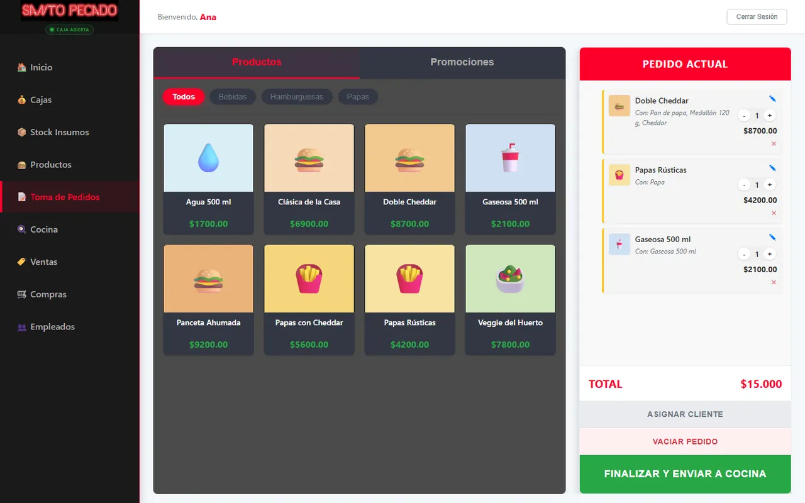
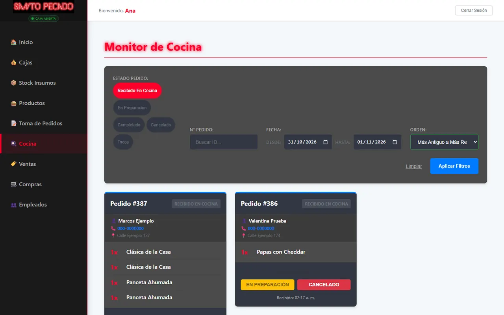
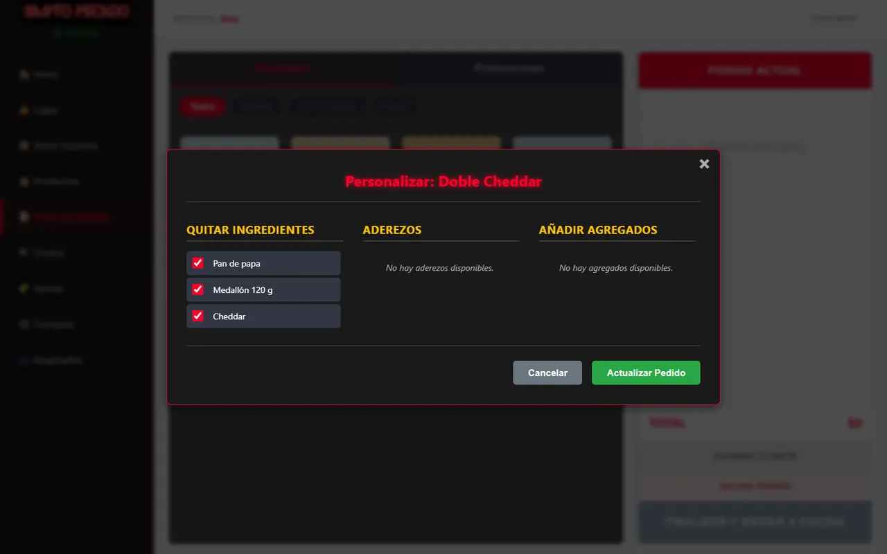
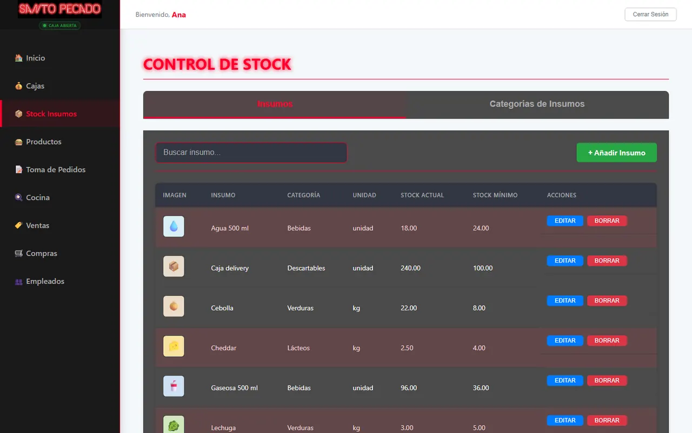
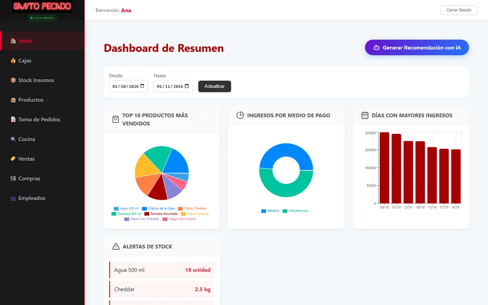
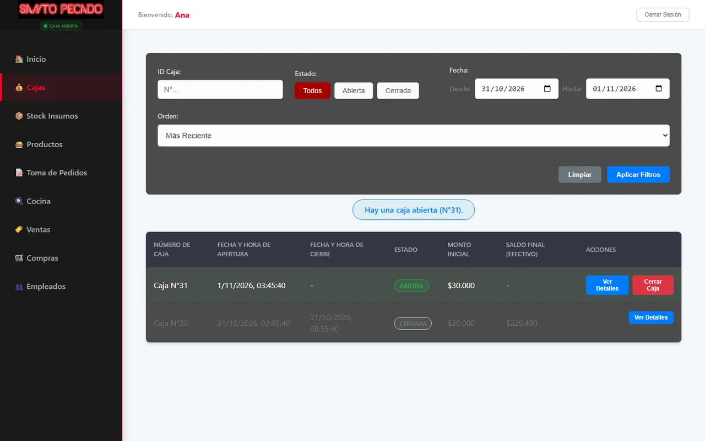

# Santo Pecado · Frontend

Interfaz del sistema de gestión de **Santo Pecado**, una hamburguesería artesanal de Salta: punto de venta, monitor de cocina, stock, caja, compras, ventas y personal. **Está en producción**, en uso diario en el local.

> Backend (Django REST): [santo-pecado-backend](https://github.com/IvanGG97/santo-pecado-backend) · Caso de estudio completo: [ivan-gutierrez.netlify.app](https://ivan-gutierrez.netlify.app/es/projects/santo-pecado/)

    

## Pantallas

| Punto de venta | Monitor de cocina |
|---|---|
|  |  |
| **Personalizar un producto** | **Control de stock** |
|  |  |
| **Dashboard** | **Caja** |
|  |  |

*Capturas con datos ficticios.*

## Qué hace

- **Punto de venta:** toma de pedidos por categoría, promociones y personalización de cada producto (quitar ingredientes o agregar extras). Lo que se quita no se descuenta del stock.
- **Monitor de cocina:** muestra los pedidos por estado y se actualiza solo cada 5 segundos. Al pasar un pedido a *En Preparación*, el backend descuenta los insumos de la receta.
- **Stock:** insumos con stock mínimo y alertas, productos y recetas.
- **Caja:** apertura, cierre e ingresos y egresos del día.
- **Compras, ventas y empleados.**
- **Dashboard:** productos más vendidos, medios de pago y días con más ingresos, más un **reporte estratégico con IA** (Gemini, a través del backend) que se descarga en PDF.
- **Cuentas:** login con JWT, registro, activación por mail y recuperación de contraseña.

## Roles

Las rutas se protegen según el rol que viaja en el JWT (`ProtectedRoute` + `AuthContext`):

| Rol | Acceso |
|---|---|
| `Admin` | Todo, incluida la gestión de empleados |
| `Encargado/Cajero` | Pedidos, cocina, caja, ventas, compras, productos y stock |
| `Cocina` | Monitor de cocina y carta |
| `Cliente` | Carta |

## Correr en local

Requisitos: Node 18 o superior y el [backend](https://github.com/IvanGG97/santo-pecado-backend) corriendo en `http://localhost:8000`.

```bash
npm install
npm start          # http://localhost:3000
```

La URL de la API está en [`src/services/api.js`](src/services/api.js).

## Estructura

```
src/
  pages/        una carpeta por pantalla (Caja, Cocina, Stock, Ventas, Dashboard…)
  components/   modales, listas, layout y ProtectedRoute
  contexts/     AuthContext: sesión, tokens y rol
  services/     cliente Axios con el token y servicio del reporte con IA
  styles/       tokens de diseño
```

---

Desarrollado por **Iván Gutiérrez** · [Portfolio](https://ivan-gutierrez.netlify.app) · [LinkedIn](https://www.linkedin.com/in/ivan-gutierrez-analista) · [GitHub](https://github.com/IvanGG97)
